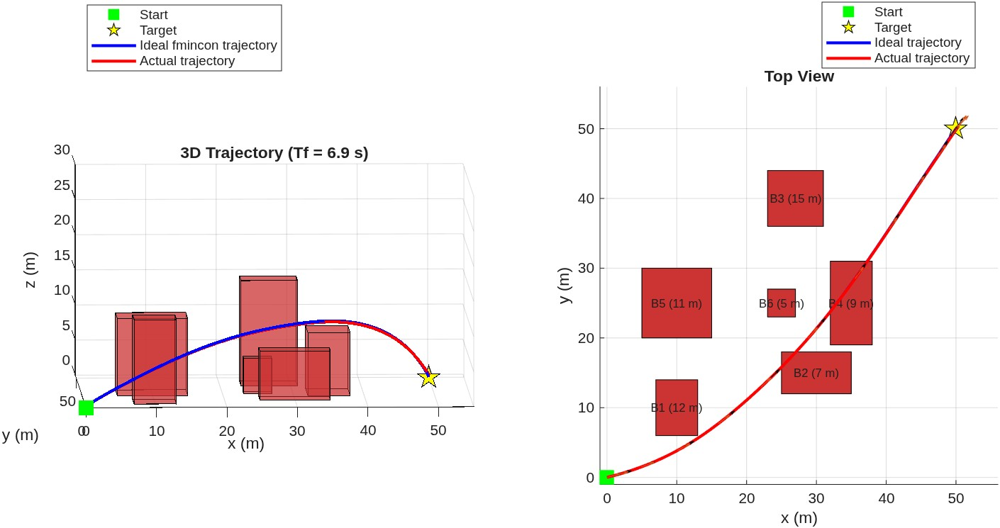

Answer to <strong>[this](https://github.com/mathworks/MATLAB-Simulink-Challenge-Project-Hub/blob/main/projects/Energy-Optimal%20Trajectory%20Planning%20for%20Multirotor%20Drones/README.md)</strong> project.


<table>
<td></td>
<td><p><h1>Energy-Optimal Trajectory Planning for Multirotor Drones</h1></p>
</table>

MATLAB implementation of an optimization-based trajectory planner for a battery-powered quadrotor. The planner computes the rotor speeds that bring the drone from an initial state to a target while minimizing the electrical energy drawn from the battery, subject to the quadrotor, brushless DC motor (BLDCM) and battery models.

The repository addresses MathWorks Challenge Project #237 (*Energy-Optimal Trajectory Planning for Multirotor Drones*) and is inspired by Schacht-Rodriguez et al. (2018), *Path planning generation algorithm for a class of UAV multirotor based on state of health of lithium polymer battery*, J. Intell. Robot. Syst. 91(1), 115-131 (`references/`).

## 1. Requirements

- Optimization ToolBox
- Symbolic Math Toolbox
- CasADi (not necessary to use `src/main.m` or `docs/main.mlx`)


## 2. Start

The NLP uses a 16-state model $[x\ y\ z\ v_x\ v_y\ v_z\ \phi\ \theta\ \psi\ p\ q\ r\ \omega_1\ldots\omega_4]$ with the rotor accelerations $\dot\omega_i$ as inputs, discretized on $N$ intervals (`nlp.N`, set in `src/init_params.m`).
The full derivation (dynamics, motor, battery, energy criterion, collocation, Hessian) is in `docs/`.

You can review this repo by simply running the `main.mlx` file under `docs/`.

If you wish to get more insights on the project, you can run `src/main.m`, which it self only runs `gen_hess_loc.m`, `nlp_solv_fmincon_2.m` and `plot_nlp_2.m`.

Example of a trajectory with obstacles:
<center>

</center>

## 3. Overview

Four solver scripts are provided:

| Script | Scenario | Solver | Hessian |
|---|---|---|---|
| `src/nlp_solv_fmincon.m` | Simple trajectory, no obstacles | `fmincon` (interior-point) | L-BFGS approximation |
| `src/nlp_solv_fmincon_2.m` | Trajectory with obstacles (buildings) | `fmincon` (interior-point) | Exact, from symbolic local blocks (`gen_hess_loc.m`); L-BFGS selectable via `use_exact_hessian` |
| `src/old/nlp_solv_casadi.m` | Same as `nlp_solv_fmincon.m` | CasADi + IPOPT | Handled by CasADi |
| `src/old/nlp_solv_casadi_2.m` | Same as `nlp_solv_fmincon_2.m` | CasADi + IPOPT | Handled by CasADi |

## 2. Repository structure

```
.
├── README.md
├── references/                 Papers used (Schacht-Rodriguez et al. 2018; morbidi2016.pdf)
├── figures/                    Figures (.jpg) and their draw.io sources (figures/src/)
├── docs/                       Complete notebook: equations, models, trajectory-solving details
│   ├── main.mlx / main.pdf     Notebook and its PDF export
│   ├── data/                   fmincon_objective.m, fmincon_constraints.m, hess_loc.m   Auxiliary files used by the notebook
└── src/                        All the code
    ├── init_params.m           Creates data/params.mat: UAV, motor, battery and NLP parameters (e.g. nlp.N)
    ├── init_scenario.m         Creates data/scenario.mat: obstacles, target, initial point (shared by all runs)
    ├── data/                   params.mat, scenario.mat (+ generated_fmincon/, git-ignored)
    ├── nlp_solv_fmincon.m      Obstacle-free trajectory, fmincon + L-BFGS
    ├── nlp_solv_fmincon_2.m    Trajectory with obstacles, fmincon + exact Hessian
    ├── gen_hess_loc.m          Symbolic generation of the exact Hessian blocks (model/hess_loc.m, data/generated_fmincon/)
    ├── plot_nlp.m              Plots obstacle-free solutions (fmincon or CasADi: uncomment the line at the top)
    ├── plot_nlp_2.m            Plots solutions with obstacles (fmincon or CasADi: uncomment the line at the top)
    ├── plot_scenario.m         Plots the flight space and the obstacles
    ├── test_aug.m              Test script for dyn_uav.m (augmented model)
    ├── test_motor_reduction.m  Test: planner model vs full motor + battery model
    ├── compare_models.m        Test: simple 12-state model (dyn) vs augmented 21-state model (dyn_uav)
    ├── model/                  Model functions (dyn, dyn_vec, dyn_uav, dyn_bldcm, dutycycle, Pm_rows, hess_loc)
    ├── old/                    CasADi versions of the two fmincon solver scripts
    ├── sols/                   Saved solutions (sol_fmincon, sol_fmincon_2, sol_casadi, sol_casadi_2 .mat)
    └── misc/                   Early separate models and Simulink tests (battery, bldcm, drone_dynamics, uav_simulink), kept for reference
```
