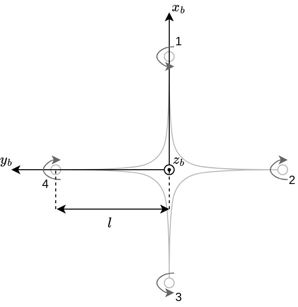
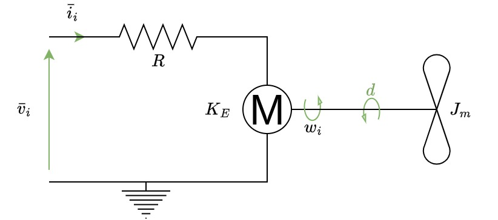
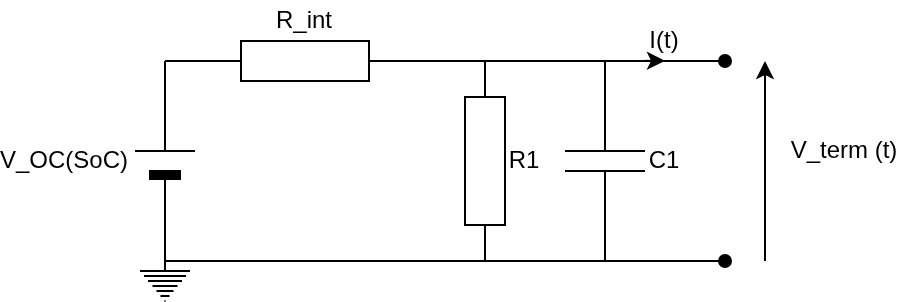
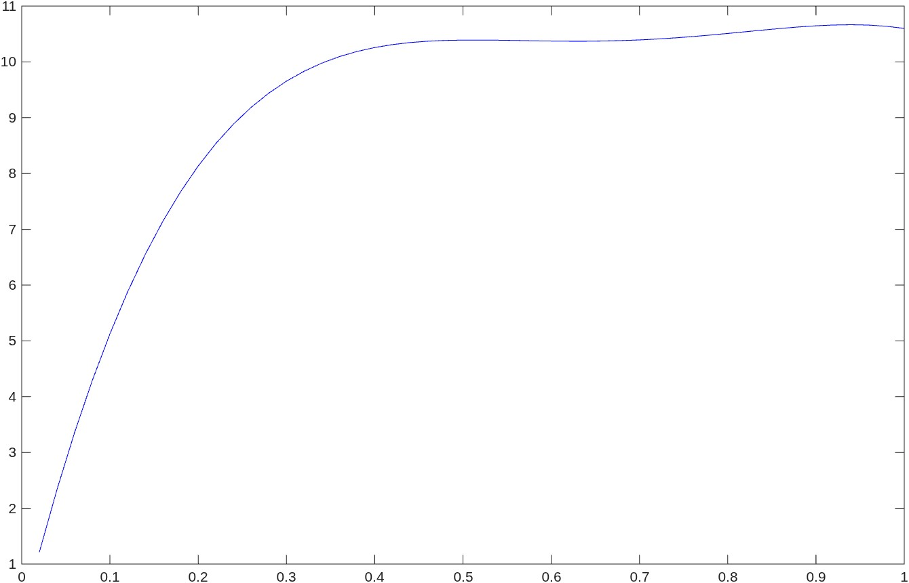
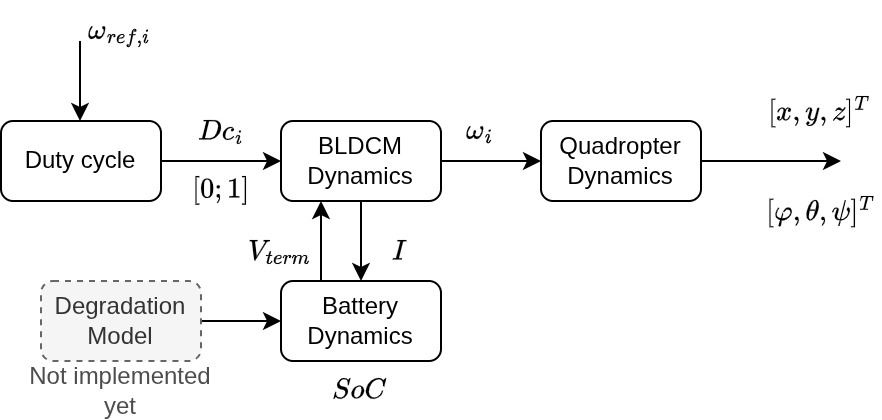

Copy of <strong>[this](https://github.com/mathworks/MATLAB-Simulink-Challenge-Project-Hub/blob/main/projects/Energy-Optimal%20Trajectory%20Planning%20for%20Multirotor%20Drones/README.md)</strong> readme.

<table>
<td></td>
<td>
<h1>Energy-Optimal Trajectory Planning for Multirotor Drones</h1>

Develop a trajectory-planning for multirotor drones that minimizes energy consumption.

</table>

## Motivation

Electric multi-rotor drones are becoming popular vehicles for variety of applications such as delivery, inspection, aerial photography, mapping and surveying, etc. Moreover, many companies are working on developing and deploying drones for passenger transport in urban areas commonly referred to as Urban Air Mobility (UAM). However, the onboard electric power source still provides a very limited operation time representing the main impediment for long distance and/or high payload rides. Thus, it is crucial to deliver, to a battery powered unmanned drone, a set of operations, including trajectory generation and following, to minimize the energy consumption increasing the success of the mission. 

## Project Description

Develop an optimization-based trajectory planning framework for a multirotor drone that generates a trajectory between initial and final points with optimal energy consumption. The framework utilizes the dynamics of the quadrotor and the battery to generate the optimal trajectory. You may use an existing MATLAB® or Simulink ® representation of a quadcopter model as the basis for your project. You will extend this by developing an optimization-based trajectory planning.    

Suggested steps:
 
1.	Create a MATLAB or Simulink model of a multi-rotor drone, including the vehicle's airframe, motor, battery, and controller. You can leverage the [UAV Toolbox](https://www.mathworks.com/products/uav.html) or the already existing [quadcopter model](https://www.mathworks.com/matlabcentral/fileexchange/63580-quadcopter-drone-model-in-simscape?s_tid=srchtitle) in [Simscape Multibody™](https://www.mathworks.com/products/simscape-multibody.html)
2.	Develop an objective function that takes into account the energy consumption of the drone (use the relation between battery and motor parameters, refer [1]).
3.	Formulate a set of constraints that considers the quadrotor dynamics, motor dynamics, battery dynamics, initial and final states, and the state of charge ([SoC](https://www.mathworks.com/solutions/power-electronics-control/battery-state-of-charge.html)) of the battery. 
4.	Solve the constrained optimization problem using the Optimization Toolbox to get the reference angular speeds of the motors. (If you want to use the Simulink model reference example, learn how to use the Optimization Toolbox  with Simulink)  
Advanced project work 
1.	Include the arriving time in the objective function.
2.	Include the battery state of health (SoH) as a constraint 

## Background Material

-	[UAV Toolbox Examples](https://www.mathworks.com/help/uav/examples.html?category=planning-and-control&s_tid=CRUX_topnav)
-	[Quadcopter Drone Model in Simscape](https://www.mathworks.com/matlabcentral/fileexchange/63580-quadcopter-drone-model-in-simscape?s_tid=srchtitle)
-	[Four Bar Linkage Optimization in Simscape](https://www.mathworks.com/matlabcentral/fileexchange/62371-four-bar-linkage-optimization-in-simscape?s_tid=srchtitle)
-	[Simscape Battery™](https://www.mathworks.com/products/simscape-battery.html)

Suggested Reading:

[1] Schacht-Rodríguez, R., Ponsart, J. C., García-Beltrán, C. D., Astorga-Zaragoza, C. M., Theilliol, D., & Zhang, Y. (2018). Path planning generation algorithm for a class of uav multirotor based on state of health of lithium polymer battery. Journal of Intelligent & Robotic Systems, 91(1), 115-131.

## Impact

Increase mission time of multirotor drones.

## Expertise Gained 

Drones, Robotics, Autonomous Vehicles, Electrification, Modeling and Simulation, Optimization, UAV

## Project Difficulty

Master's, Doctoral

## Project Discussion

[Dedicated discussion forum](https://github.com/mathworks/MathWorks-Excellence-in-Innovation/discussions/73) to ask/answer questions, comment, or share your ideas for solutions for this project.

## Project Number

237

<!--
Implementation notes (not rendered):
- dyn.m must use the spin convention of Section 1.3: replace
  [0;0;w1-w2+w3-w4] by [0;0;-w1+w2-w3+w4] in the gyroscopic term.
- K_E, R, J_r, D_f (and L, T_f if used) are not yet in init_params.m.
- simu.m: rename the variables `deg2rad` and `eps`, which shadow built-in functions.
-->

## Abstract

The following repo aims at addressing the topic above.
It shall compare two strategies:
- Resolving a NLP (Open-loop)
- Following a polynomial trajectory (Closed-loop)

This project is heavily inspired of the paper [Path Planning Generation Algorithm for a Class of UAV Multirotor
Based on State of Health of Lithium Polymer Battery](https://doi.org/10.1007/s10846-018-0870-0) but takes some liberties were taken.
The battery features no thermodynamics model, nor degradation models as it serves no purpose in our case.

A table of all parameters and their value can be found at the end of this page.

## 1. Quadrotor dynamics

### 1.1 Frames and conventions

The vehicle is a rigid body actuated by four brushless DC motors mounted on a symmetric frame. Two frames are used.

- $E_0$ is the inertial frame, with $z_0$ pointing upward, consistent with the gravity term $-mgE(3)$ below.
- $E_b$ is the body frame, attached to the centre of mass. The $x_b$-axis passes through the centre of mass and rotor 1, the $y_b$-axis through the centre of mass and rotor 2, and the $z_b$-axis is vertical.

With $z_b$ pointing up, the rotors are numbered clockwise when seen from above. Their positions in $E_b$ are:

| Rotor | 1 | 2 | 3 | 4 |
|---|---|---|---|---|
| Position in $E_b$ | $(+l,0,0)$ | $(0,-l,0)$ | $(-l,0,0)$ | $(0,+l,0)$ |

  

> **Assumptions.** \
> **(H1)** The airframe is a rigid body of constant mass $m$ and constant inertia $I=\mathrm{diag}(I_x,I_y,I_z)$. The inertia is diagonal in $E_b$ because of the symmetry of the frame. \
> **(H2)** The centre of mass coincides with the geometric centre of the frame. \
> **(H3)** The thrust and the reaction torque of each rotor are quadratic in its angular speed. \
> **(H4)** Aerodynamic drag on the body is neglected.

The attitude is parametrized by the Euler angles $\eta=[\phi,\theta,\psi]^\top$ (roll, pitch, yaw). The rotation matrix from $E_b$ to $E_0$ is

$$
R_b =
\begin{bmatrix}
c_\psi c_\theta & c_\psi s_\theta s_\phi - s_\psi c_\phi & c_\psi s_\theta c_\phi + s_\psi s_\phi \\
s_\psi c_\theta & s_\psi s_\theta s_\phi + c_\psi c_\phi & s_\psi s_\theta c_\phi - c_\psi s_\phi \\
-s_\theta & c_\theta s_\phi & c_\theta c_\phi
\end{bmatrix}
$$

where $c_\cdot=\cos(\cdot)$ and $s_\cdot=\sin(\cdot)$. The Euler-angle parametrization is singular at $\theta=\pm\pi/2$, so the model is valid for moderate pitch only. For a vector $a\in\mathbb{R}^3$, $\hat a$ denotes the skew-symmetric matrix such that $\hat a\,b=a\wedge b$, where $\wedge$ is the cross product.

### 1.2 Newton-Euler equations

Let $\xi=\begin{bmatrix}x&y&z\end{bmatrix}^T$ be the position of the centre of mass in $E_0$. The rigid-body dynamics are

$$
\begin{aligned}
\dot{\xi} &= v\\
m\dot{v} &= f\\
\dot{R_b} &= R_b \hat{\bar{\Omega}}\\
I\dot{\bar{\Omega}} &= - \bar{\Omega} \wedge I\bar{\Omega} + \Gamma
\end{aligned}
$$

where $v\in E_0$ is the linear velocity, $f\in E_0$ the sum of the external forces (thrust and gravity), $\bar\omega\in E_b$ the angular velocity and $\Gamma\in E_b$ the total external torque. The first two equations are Newton's second law for the translation. The last two are the rotation kinematics and Euler's equation. The term $-\bar\omega\wedge I\bar\omega$ is the gyroscopic coupling of the rigid body.

### 1.3 Forces and torques generated by the rotors

Each rotor $i$ spins at $\omega_i$ and produces a thrust $k_T\omega_i^2$ along $z_b$. The total thrust and the gravitational force are :

$$T_{thr} = k_T \sum_{i=1}^4\omega_i^2, \qquad f_g = -mgE(3), \qquad E(3)=\begin{bmatrix}0&0&1\end{bmatrix}^T .$$

A thrust $k_T\omega_i^2$ applied at $(x_i,y_i,0)$ produces the torque $(y_i k_T\omega_i^2,\,-x_i k_T\omega_i^2)$ about $x_b$ and $y_b$. With the rotor positions of Section 1.1, the torques generated by the rotors in $E_b$ are :

$$
\Gamma(E_b) =
\begin{bmatrix}
l\,k_T(-\omega_2^2 + \omega_4^2) \\
l\,k_T(-\omega_1^2 + \omega_3^2) \\
k_Q(\omega_1^2 - \omega_2^2 + \omega_3^2 - \omega_4^2)
\end{bmatrix}
$$

where $l$ [m] is the distance from each rotor to the centre of mass, $k_T$ [N/(rad/s)$^2$] the thrust coefficient and $k_Q$ [N·m/(rad/s)$^2$] the reaction-torque coefficient.

Let $s_i=\pm1$ be the spin sense of rotor $i$ about $+z_b$. At constant speed, the aerodynamic drag torque on rotor $i$ is $-s_ik_Q\omega_i^2E(3)$, and the reaction on the airframe is $-s_ik_Q\omega_i^2E(3)$. The yaw torque above therefore corresponds to $s=(-1,+1,-1,+1)$:

> **Spin convention.** Rotors 1 and 3 spin clockwise and rotors 2 and 4 counter-clockwise, seen from above.

The total angular momentum of the rotors along $z_b$ is $J_r\,\omega_G$ with

$$\omega_G=\sum_{i=1}^4 s_i\omega_i=-\omega_1+\omega_2-\omega_3+\omega_4 ,$$

where $J_r$ is the rotor inertia. This quantity is **linear** in the rotor speeds, unlike the thrust and the reaction torque. Since the rotors rotate with the airframe, their angular momentum contributes the gyroscopic torque

$$\Gamma_{gyro}=-(\bar{\Omega}\wedge E(3))\,J_r\,\omega_G ,\qquad \Gamma=\Gamma(E_b)+\Gamma_{gyro}.$$

Substituting into the Newton-Euler equations, with $U_1=T_{thr}$, gives the full model

$$
\begin{aligned}
\dot{\xi} &= v\\
m\dot{v} &= R_b E(3)\,T_{thr} - mgE(3)\\
\dot{R_b} &= R_b \hat{\bar{\Omega}}\\
I\dot{\bar{\Omega}} &= - \bar{\Omega} \wedge I\bar{\Omega} + \Gamma(E_b) + \Gamma_{gyro}
\end{aligned}
$$

### 1.4 Scalar equations of motion

The third column of $R_b$ gives the direction of the thrust in $E_0$:

$$
\ddot{\xi} = \frac{1}{m} R_b \begin{bmatrix}0 \\ 0 \\ U_1 \end{bmatrix} - \begin{bmatrix}0 \\ 0 \\ g \end{bmatrix}
$$

$$
\begin{aligned}
\ddot{x} &= (c_\psi s_\theta c_\phi + s_\psi s_\phi)\frac{U_1}{m}\\
\ddot{y} &= (s_\psi s_\theta c_\phi - c_\psi s_\phi)\frac{U_1}{m}\\
\ddot{z} &= -g+(c_\theta c_\phi)\frac{U_1}{m}
\end{aligned}
$$

Let $U_2=\Gamma_\phi$, $U_3=\Gamma_\theta$ and $U_4=\Gamma_\psi$ be the torque inputs, and let $[p,q,r]^\top=\bar\omega$ be the body rates. The Euler-angle rates satisfy $\dot{\eta}=W(\eta)\,\bar\omega$ with

$$W = \begin{bmatrix}
1 & s_\phi t_\theta & c_\phi t_\theta \\
0 & c_\phi & -s_\phi \\
0 & s_\phi/ c_\theta & c_\phi/ c_\theta
\end{bmatrix}$$

> **Approximation (small angles).** $W\simeq I_3$, i.e. $\dot\eta\simeq\bar\omega$. Since $W-I_3=O(\|\eta\|)$, the error on $\dot\eta$ is $O(\|\eta\|\,\|\bar\omega\|)$. The approximation is acceptable only for small roll and pitch. Its validity for the planned trajectories must be checked a posteriori.

Under A1, with $p\simeq\dot\phi$, $q\simeq\dot\theta$ and $r\simeq\dot\psi$, the components of Euler's equation are obtained as follows. The gyroscopic coupling gives, for the first axis, $-(\bar\omega\wedge I\bar\omega)_x=(I_y-I_z)\,q\,r$, and the other axes follow by cyclic permutation. Using $\bar\omega\wedge E(3)=[q,\,-p,\,0]^\top$, the rotor gyroscopic torque is $\Gamma_{gyro}=J_r\omega_G[-q,\;p,\;0]^\top$. Hence

$$
\begin{aligned}
\ddot{\phi} &= \frac{I_y-I_z}{I_x}\dot{\theta}\dot{\psi} - \frac{J_r}{I_x}\omega_G\dot{\theta}+\frac{U_2}{I_x}\\
\ddot{\theta} &= \frac{I_z-I_x}{I_y}\dot{\phi}\dot{\psi} + \frac{J_r}{I_y}\omega_G\dot{\phi}+\frac{U_3}{I_y}\\
\ddot{\psi} &= \frac{I_x-I_y}{I_z}\dot{\theta}\dot{\phi} +\frac{U_4}{I_z}
\end{aligned}
$$

The torque $J_r\dot\omega_G$ due to the acceleration of the rotors acts on the yaw axis and is neglected in this model. For a single rotor accelerating by 20 rad/s over the motor time constant of Section 2 ($\approx23$ ms), it is of order $2.6\times10^{-2}$ N·m. This is not negligible compared with the corresponding variation of the reaction torque, $\approx6\times10^{-3}$ N·m, so the yaw dynamics are inaccurate during fast speed transients.

### 1.5 Actuator allocation

The inputs are linear in the squared rotor speeds:

$$
\begin{aligned}
U_1 &= k_T(\omega_1^2 + \omega_2^2 + \omega_3^2 + \omega_4^2) \\
U_2 &= l\,k_T(-\omega_2^2 + \omega_4^2) \\
U_3 &= l\,k_T(-\omega_1^2 + \omega_3^2) \\
U_4 &= k_Q(\omega_1^2 - \omega_2^2 + \omega_3^2 - \omega_4^2)
\end{aligned}
$$

In matrix form, $U=M\,[\omega_1^2,\dots,\omega_4^2]^\top$ with

$$
M=\begin{bmatrix}
k_T & k_T & k_T & k_T \\
0 & -lk_T & 0 & lk_T \\
-lk_T & 0 & lk_T & 0 \\
k_Q & -k_Q & k_Q & -k_Q
\end{bmatrix}\in\mathbb{R}^{4\times4}.
$$

The rows of $M$ are pairwise orthogonal and non-zero, so $M$ is invertible whenever $k_T,k_Q,l\neq0$. Any $U$ can therefore be mapped to the squared rotor speeds through $M^{-1}$.

> **Constraint.** The condition and $0\le\omega_i\le\omega_{max}$ restrict the attainable set in $U$-space. This matters for the optimization, whether the decision variables are the $\omega_i$ or the $U_j$.

### 1.6 Nonlinear state-space model

The model is nonlinear, time-invariant, continuous-time, MIMO (12 states, 4 inputs) and deterministic. The state and input are

$$X=\begin{bmatrix}x&y&z&v_x&v_y&v_z&\phi&\theta&\psi&p&q&r\end{bmatrix}^\top\in\mathbb{R}^{12},\qquad \omega=\begin{bmatrix}\omega_1&\dots&\omega_4\end{bmatrix}^\top\in\mathbb{R}^{4},$$

and the full model under **A1** can be written as:

$$
\dot{X}=f(X,\omega)=
\begin{bmatrix}
x_4\\ x_5\\ x_6\\
(c_{x_7}s_{x_8}c_{x_9}+s_{x_7}s_{x_9})\dfrac{U_1}{m}\\
(c_{x_7}s_{x_8}s_{x_9}-s_{x_7}c_{x_9})\dfrac{U_1}{m}\\
-g+c_{x_7}c_{x_8}\dfrac{U_1}{m}\\
x_{10}+s_{x_7}t_{x_8}x_{11}+c_{x_7}t_{x_8}x_{12}\\
c_{x_7}x_{11}-s_{x_7}x_{12}\\
(s_{x_7}x_{11}+c_{x_7}x_{12})/c_{x_8}\\
\dfrac{I_y-I_z}{I_x}x_{11}x_{12}-\dfrac{J_r}{I_x}\omega_G x_{11}+\dfrac{U_2}{I_x}\\
\dfrac{I_z-I_x}{I_y}x_{10}x_{12}+\dfrac{J_r}{I_y}\omega_G x_{10}+\dfrac{U_3}{I_y}\\
\dfrac{I_x-I_y}{I_z}x_{10}x_{11}+\dfrac{U_4}{I_z}
\end{bmatrix}
$$

with $U=M[\omega_1^2,\dots,\omega_4^2]^\top$ and $\omega_G=-\omega_1+\omega_2-\omega_3+\omega_4$.

> **Note.** The "real" model uses the exact kinematics $\dot\eta=W(\eta)\bar\omega$. A1 will only help reducing the NLP solving computations. \
> The matrix above remains singular at $\theta=\pm\pi/2$.

## 2. Hover and linearization

### 2.1 Hover equilibrium

Take $\phi=\theta=0$, zero velocities, zero body rates and a constant $\omega_i=\omega_h$ for all $i$. Then $U_2=U_3=U_4=0$ and $\omega_G=0$, so the horizontal accelerations vanish. The vertical equation gives $U_1=mg$. Since $M$ is invertible, this is the only equilibrium with $\omega_i^2\ge0$, and

$$\omega_h=\sqrt{\frac{mg}{4k_T}}=\sqrt{\frac{0.5\times9.81}{4\times3\times10^{-5}}}\approx202.18\ \text{rad\,s}^{-1}\ (\approx1931\ \text{rpm}).$$

### 2.2 Linearization

The only purpose of a linearized model would be for a closed loop control. Which may be addressed in the future.

The hover equilibria form a family parametrized by $(x^*,y^*,z^*,\psi^*)$. Rotating $E_0$ about $z_0$ sets $\psi^*=0$ without loss of generality. Let $\delta X=X-X^*$ and $\delta U=[U_1-mg,\,U_2,\,U_3,\,U_4]^\top$, which removes the constant $-g$ term. A first-order expansion gives:

- $\ddot x\simeq g\,\delta\theta$ and $\ddot y\simeq -g\,\delta\phi$. The sign of the second relation follows from $\partial_\phi(s_\psi s_\theta c_\phi-c_\psi s_\phi)=-1$ at the equilibrium.
- $\delta\ddot z=\delta U_1/m$.
- $W(0)=I_3$, so $[\delta\dot\phi,\delta\dot\theta,\delta\dot\psi]^\top=[\delta p,\delta q,\delta r]^\top$ exactly, without invoking A1.
- The products $qr$, $pr$, $pq$, $\omega_Gq$ and $\omega_Gp$ are second order in the deviations and are dropped.

The linear model is :

$$
\delta\dot X=A\,\delta X+B_U\,\delta U,\qquad
A=\begin{bmatrix}
0 & I_3 & 0 & 0 \\
0 & 0 & A_{v\eta} & 0 \\
0 & 0 & 0 & I_3 \\
0 & 0 & 0 & 0 \end{bmatrix},\quad
A_{v\eta}=\begin{bmatrix}
0 & g & 0 \\
-g & 0 & 0 \\
0 & 0 & 0 \end{bmatrix}
$$

where the blocks of $A$ follow the partition $(\xi,v,\eta,\bar\omega)$ and $B_U\in\mathbb{R}^{12\times4}$ has only four non-zero entries:

$$
(B_U)_{6,1}=\frac1m,\qquad (B_U)_{10,2}=\frac1{I_x},\qquad (B_U)_{11,3}=\frac1{I_y},\qquad (B_U)_{12,4}=\frac1{I_z}.
$$

With the rotor speeds as inputs, $\delta U=2\omega_hM\,\delta\omega$ because $\partial(\omega_i^2)/\partial\omega_i=2\omega_h$, hence

$$B_\omega=2\omega_h\,B_U\,M .$$

>**Note.** `test_base.m`'s second test computes $(A,B_\omega)$ numerically by central finite differences. The analytical expressions above serve as a check.

### 2.3 Structural properties

- $A$ is nilpotent with $A^4=0$. All 12 eigenvalues are zero, in Jordan blocks of sizes $(4,4,2,2)$ corresponding to the chains $x$, $y$, $z$ and $\psi$.
- Hover is therefore not asymptotically stable in open loop. It is Lyapunov unstable, with polynomial divergence.
- The pair $(A,B_U)$ is in Brunovsky form with controllability indices $(4,4,2,2)$, which sum to 12, so it is controllable. $B_\omega$ and $B_U$ have the same range because $M$ and $\mathrm{diag}(\omega_h)$ are invertible, so $(A,B_\omega)$ is controllable too.
- Since the pair is controllable, an LQR gain exists for $Q>0$, $R>0$, and it is unique. The weights are chosen with Bryson's rule, $Q=\mathrm{diag}(1/x_{i,max}^2)$ and $R=\mathrm{diag}(1/u_{i,max}^2)$.
- Observability is not addressed. The simulations assume full-state feedback and no sensor noise.

## 3. Brushless DC motor model

Each rotor is driven by a brushless DC motor modelled as an equivalent DC machine.

  

The electrical and mechanical equations are

$$\begin{equation}
L\dot{\bar{i}}_i = \bar{v}_i - R\bar{i}_i - K_E\omega_i
\end{equation}$$

$$\begin{equation}
J_r\,\dot{\omega}_i = K_E\bar{i}_i - d\,\omega_i^2 - D_f\,\omega_i - T_f\,\mathrm{sign}(\omega_i)
\end{equation}$$

where $V_i$ is the applied voltage, $I_i$ the current, $R$ and $L$ the winding resistance and inductance, $K_E$ the back-EMF constant, $J_r$ the rotor inertia, $d$ the propeller load coefficient, $D_f$ the viscous friction coefficient and $T_f$ the dry friction torque. **WTF** In SI units, the torque constant equals the back-EMF constant, $K_T=K_E$. \
<!--TODO: a changer!!!!-->
The four terms of the mechanical equation are:

1. **Electromagnetic torque** $\tau_{em}=K_EI_i$. The back-EMF is $K_E\omega_i$, and the current is $I_i=(V_i-K_E\omega_i)/R$ when the electrical dynamics are neglected.
2. **Propeller load** $\tau_{prop}=d\,\omega_i^2$, with $d=k_Q$. It is the aerodynamic reaction torque of the propeller, quadratic in the speed. It couples the motor to the airframe dynamics and appears in $\Gamma_\psi$.
3. **Viscous friction** $\tau_{visc}=D_f\,\omega_i$, representing bearing losses and viscous drag of the rotor.
4. **Dry friction** $\tau_{dry}=T_f\,\mathrm{sgn}(\omega_i)$.

> **Assumption.** \
> **(M1)** $D_f=T_f=0$. \
> **(M2)** (quasi-static current) $L\dot I_i\simeq0$. This singular-perturbation reduction is valid when $L/R\ll\tau_m$, where $\tau_m$ is the mechanical time constant defined below.

### 3.1 Duty-cycle

The ESC of the BLCM controls the voltage using Pulse-Width Modulation. The voltage and current are generated as follows:

$$\begin{align}
\bar{v}_i &= V_{term} \cdot D_{C,i} \\
I_{BLDCM,i} &= \bar{i}_i \cdot D_{C,i}
\end{align}$$

Where $V_{term}$ Is the voltage output of the battery, and $I_{BLDCM,i}$ is the current of the $i^{th}$ motor.

The duty-cycle can be determined through experimental correlations, however, we chose to make a simple feedforward function $D_{c,i}=f(\omega_{i,ref})$ using the electrical and mecanical equations above in steady state.

Assuming $V_{term} \simeq E_{ocv}$, **M1** and **M2**:

$$\begin{equation}
D_C = \frac{\bar{v}_i}{E_{ocv}}=\frac{R\,d}{K_E\,E_{ocv}}\omega_{ref}^2 + \frac{K_E}{E_{ocv}}\omega_{ref}
\end{equation}$$

See section 4.3 for $E_{ocv}$.

## 3.2 Motor dynamics

Finally the BLDCM equation can be written as:
$$\boxed{\dot{\omega_i} = \frac{1}{J_r}(K_E\,\bar{i}_i-k_Q)\, \omega_i^2}$$

with $$\bar{i}_i = \frac{V_{term} \cdot D_{C,i}-K_E\,\omega_i}{R}$$

## 4. Battery model

The battery is modelled by a Thévenin equivalent circuit. The model provides the terminal voltage, the discharge current drawn by the four motors and the state of charge (SoC), which is later used as an additional state and as a constraint of the trajectory optimization.

There are no Health model, nor temperature model for this battery. It may change in the future.

> **Assumptions.** \
> **(B1)** The battery is a 3S LiPo pack, i.e. $N_s=3$ cells in series. Total voltage output is $3\times3.7=11.1V$ \
> **(B2)** The temperature is constant, so no thermal model is used and $R_{\text{int}}$ and $C_{\text{batt}}$ do not vary with temperature. \
> **(B3)** The current is positive during discharge. \
> **(B4)** The resistance $R_{\text{int}}$ and the capacity $C_{\text{batt}}$ are constant. Ageing (state of health) is not modelled. 

### 4.2 Equivalent circuit

The first-order Thévenin model consists of an open-circuit voltage source $V_{oc}(\text{SoC})$ in series with an internal resistance $R_{\text{int}}$ and with a parallel branch $R_1\parallel C_1$ that represents the diffusion dynamics:

  

The branch $R_d\parallel C_d$ is neglected (i.e. $V_d(t)=0$), which removes the diffusion dynamics. The model then reduces to a purely resistive one, which is static (algebraic) and no longer of first order:

$$\boxed{V_{oc}(\text{SoC}) = V_{\text{term}}(t) + R_{\text{int}} \, I(t)}$$

The consequence is that the terminal voltage responds instantaneously to a change of current, whereas the full circuit would show a transient with time constant $R_dC_d$.

### 4.3 Open circuit voltage
The voltage output of the battery is a function of the State of Charge (SoC). It can be experimentally defined as:

$$V_{oc}=\sum_{i=0}^n \lambda_i\,SoC^i + ln(SoC)SoC$$

For the sake of the project, we chose to represente it as a 4-degree polynomial function.

|$\lambda_0$|$\lambda_1$|$\lambda_2$|$\lambda_3$|$\lambda_4$|
|---|---|---|---|---|
|$0$|$67.61$|$-155.4$|$153.4$|$-54.51$|

With $V_{OC}(1)=E_{OCV}$

  

### 4.4 State-of-charge dynamics

$$\boxed{\dot{\text{SoC}}(t) = -\frac{I(t)}{C_{\text{batt}}}}$$

where $C_{\text{batt}}$ is the battery capacity in ampere-seconds [A·s] (a capacity of $x$ mAh corresponds to $3.6\,x$ A·s). The equation is dimensionally consistent: $[\mathrm{A}]/[\mathrm{A\,s}]=[\mathrm{s^{-1}}]$. It is a pure Coulomb counting, i.e. it assumes a unit coulombic efficiency and a capacity independent of the discharge rate (no Peukert effect). The SoC is dimensionless, with $\text{SoC}\in[0,1]$. \
Also, $I(t) = \sum_{k=1}^4I_{BLDCM,k}$

## Augmented model

Following the previous sections, we can write the augmented state model of the drone:

$$
\begin{aligned}
\dot{\xi} &= v\\
m\dot{v}  &= R_b E(3)\,T_{thr} - mgE(3)\\
\dot{R_b} &= R_b \hat{\bar{\Omega}}\\
I\dot{\bar{\Omega}} &= - \bar{\Omega} \wedge I\bar{\Omega} + \Gamma(E_b)\\
\dot{\omega_i} &= \frac{1}{J_r}(K_E\,\bar{i}_i-k_Q)\, \omega_i^2, \quad \bar{i}_i = \frac{V_{term} \cdot D_{C,i}-K_E\,\omega_i}{R}\\
\dot{SoC} &= -\frac{\sum_{k=1}^4D_{C,k}\bar{i}_k}{C_{batt}}
\end{aligned}
$$

which iteractions can be represented as follows:

  

## Parameters

| Parameter | Desciption | Value | Unit |
|---|---|---|---|
| **Drone** |
| $m$ | Mass | $0.5$ | $kg$ |
| $k_T$ | Propeller thrust coefficient | $3\times10^{-5}$ | $N/(rad/s)^2$ |
| $k_Q$ | Propeller load | $7.5\times10^{-7}$ | $N·m/(rad/s)^2$ |
| $l$ | Arm length | $0.25$ | $m$ |
| $J_{xx}$ | x-axis inertia | $5\times10^{-3}$ | $kg\cdot m^2$ |
| $J_{yy}$ | y-axis inertia | $5\times10^{-3}$ | $kg\cdot m^2$ |
| $J_{zz}$ | z-axis inertia | $9\times10^{-3}$ | $kg\cdot m^2$ |
| **Battery** |
| $R_{int}$ | Internal resistance | $0.05$ | $\Omega$ |
| $E_{OCV}$ | Open circuit voltage rating | $11.1$ | $V$ |
| $C_{batt}$ | Capacity | $4680$ | $A\cdot s$ |
| $\eta_m$ | BLDCM yield | $0.85$ |  |
| $P_{av}$ | Avionics | 0 | $W$ |
| **BLDCM** |
| $K_E$ | Back-EMF constant | $0.01$ | $V\cdot s/rad$ |
| $R$ | Internal resistance | $0.1$ | $\Omega$ |
| $J_r$ | Rotor inertia | $3\times10^{-5}$ | $kg\cdot m^2$ |
| $d=k_Q$ | Propeller load | $7.5\times10^{-7}$ | $Nm/(rad/s)^2$ |
| $D_f$ | Viscous friction coefficient | $0$ | $Nm\cdot s/rad$ |
| $T_f$ | Dry friction | $0$ | $Nm$ |
| $L$ | Inductance | $0$ | $H$ |